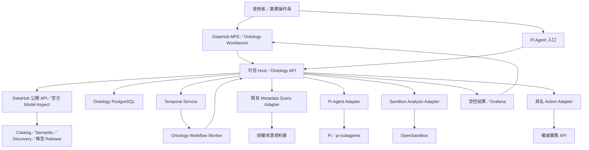
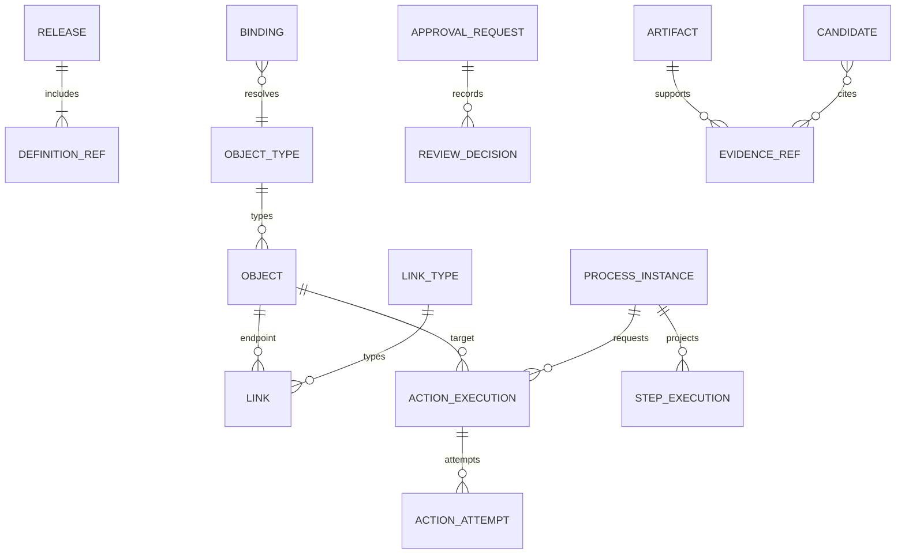
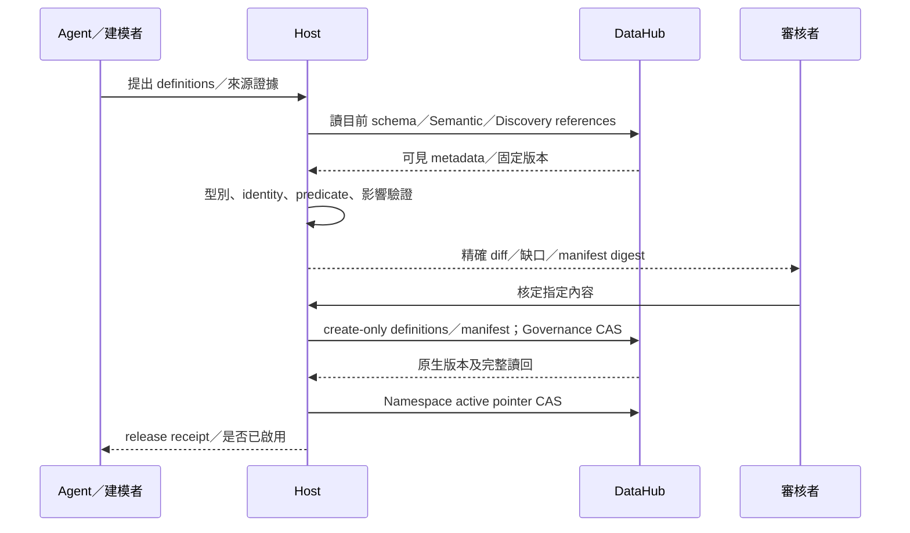
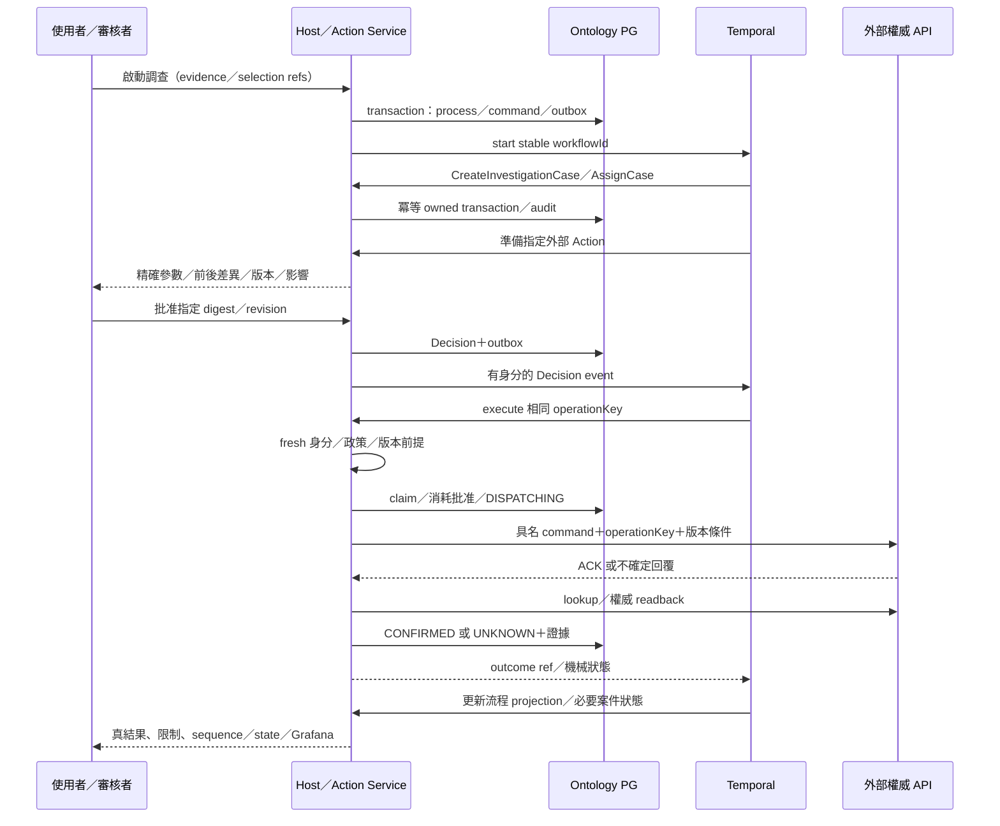

# DataHub Operational Ontology v1 — 實作設計規格

版本：`ontology-design/1.0` · 日期：2026-10-02 · 狀態：**設計基準已確認；產品尚未實作／部署。**

讀者：負責 Host、DataHub Model、Temporal、Agent、分析、前端及驗收的開發者。本文件是開發與驗收基準，不是新服務、資料複製、來源 SQL、模型費用或外部寫入的操作批准。

## 0. 使用方式、決策與適用範圍

### 0.1 已確認的設計決策

| ID | 決策 | 對實作的約束 |
| --- | --- | --- |
| D01 | 產品涵蓋業務物件、邏輯、行動與權限 | 不以詞彙庫、圖譜或查詢計畫代替營運閉環 |
| D02 | DataHub metadata 為模型定義／release 權威 | 官方 Model／Aspect 擴充；不修改 Core、不另建可獨立編輯的 registry |
| D03 | 允許 Ontology 所需的新 datastore | 新 Ontology PostgreSQL；此例外只適用本功能，不搬既有 Semantic／Discovery 紀錄 |
| D04 | **Temporal 為唯一流程推進引擎；第一版不加入 Tork** | 不另實作 Southstar 式業務 scheduler；可借其 attempt、契約與對帳設計 |
| D05 | Pi／pi-subagents 負責動態 Agent 協作 | 不是業務狀態權威、批准者或來源 writer |
| D06 | Python／ML 沿用 OpenSandbox 分析邊界 | 不在 Host／一般 Pi worker 執行生成程式，不提供來源 writer secrets |
| D07 | **第一版來源讀取沿用 metadata ACL** | 不新增來源列級權限、逐人 SELECT grants 或逐題批准；DB 仍依實際連線身分授權 |
| D08 | 新案件、批准及 Action 有獨立營運權限 | 不把「可讀來源」當「可讀任何案件／可執行任何 Action」 |
| D09 | 統一關係圖、保留不同語義 | Class／Process／Sequence／State／Lineage／Evidence 是同一模型的視圖 |
| D10 | 基準流程為「證據 → 調查案件 → 指派／審核 → 外部 Action → 讀回」 | 真來源、異常規則與外部 API 可配置；不得假造現場能力 |
| D11 | 沿用現行模型資料揭露限制 | 業務值、來源業務鍵、候選配對、原始結果與日誌不自動進模型／Pi history |

D04、D07、D10 由本輪 `ask_user` 明確確認。其餘承接前輪已確認方向與現有安全契約。本文取代三份研究報告中仍保留的選型分支：新 store 不再是模型 registry 權威；Tork 不再是 v1 主線；共同來源列級政策不列入 v1。

### 0.2 規範層級

- **MUST／必須**：開發與驗收要求；未通過不能宣稱該能力完成。
- **v1 預設**：新功能的保守設計值，尚未套用現場；可由受控部署設定收緊。提高成本、資料或來源負載上限需相應批准。
- **接入條件**：實際環境須提供的來源／API／身分／版本證據，不是任意留給開發者選擇的架構空白。
- 所有本文件新增的型別、路徑、API、表與工具，除明確標示「既有」者外，均為**待實作**，不是目前已可呼叫的介面。

### 0.3 可以直接開發，哪些不能憑文件啟用

本文件已足以實作契約、模型插件、領域服務、Temporal workflow、UI 及隔離回歸。真實啟用仍須完成 §16 的能力驗證及接入設定；不以補造 URL、帳號、版本 digest、物件鍵或異常門檻消除缺項。

第一輪交付必須包含 §1 的完整能力與 §15 的必要驗收。只有 ontology-owned 案件成功，不能宣稱外部 Action 已完成；合成資料與假 API 只能證明對應測試範圍。

## 1. 產品能力與非目標

### 1.1 使用者可見的完成線

| 要求 | 使用者能力 | 完成證據 |
| --- | --- | --- |
| R01 模型 | 從可見 metadata、Semantic、Discovery 證據提出並發布 Object／Link／Binding／Function／Action／Process | 原生模型讀回、完整固定 release、可追溯差異 |
| R02 物件 | 從真來源解析物件與關係，查看來源、值、版本、as-of、缺口 | 真受控 Query 與物件結果相符；鍵不碰撞 |
| R03 分析 | Agent 選方法、生成 Python，在真 OpenSandbox 產生證據／候選 | 程式／輸入／映像 provenance、受控結果、候選與核定分離 |
| R04 營運 | 建立、指派、審核案件，執行具名 Action | 案件真持久化；外部權威讀回，不只 HTTP ACK |
| R05 流程 | 跨重新整理、Host／worker 重啟、人審與外部等待持續推進 | 同一流程與 operation identity；完成工作不重播 |
| R06 工作台 | 切換同一模型的 Class／Process／Sequence／State／Lineage／Evidence | 定義圖與真執行圖明確區分，身分與版本一致 |
| R07 觀察 | 由 Query／Grafana 檢視結果與行動後變化 | 原生圖表、受控讀回、不因 reload 重跑 SQL／Action |
| R08 持續維護 | 後續 schema、定義、證據或政策改變後，比較、更新或失效 | 真第二輪變更；保留人工內容、舊 release 與歷史理由 |

### 1.2 v1 不做

- 完整 Palantir 替代品、完整 UML／fUML／PSSM／XMI 相容。
- Tork、第二套 scheduler、額外 graph DB／向量庫、通用插件市場。
- 跨來源 SQL federation、全庫自動物化、未批准 CDC、任意 DML／URL／shell Action。
- 來源列級隔離或個人 DB／RLS 身分。新增案件 ACL 不能被宣稱為來源資料列 ACL。
- 全功能 scenario simulation、通用視覺化任意程式編輯器、任意流程熱遷移。
- 以成功 ML／技術驗證自動核准業務 Link，或把 Lineage 當 Join。

以上非目標不取消 R01–R08。跨日等待、恢復與外部 UNKNOWN 對帳屬 v1 必要能力。

## 2. 系統架構與責任



### 2.1 模組主責

| 模組 | 必須負責 | 禁止越界 |
| --- | --- | --- |
| Catalog／Semantic | schema、owner、詞彙、口徑、metadata 維護 | 不存每筆業務 Object；不搬原 Task／Run／Decision |
| Discovery | 程式／SQL／ETL／API／BI 的依賴證據及未知 | 靜態候選不是已發生的執行或核准 Link |
| Model Adapter | 定義、release、原生 ACL／CAS、完整讀回、相容性 | 不寫 Core 內部 DB；不以 runtime cache 替代定義權威 |
| Object Service | identity、Binding、property ownership、as-of、typed Link | 不由 LLM 編造值；不以同名合併身份 |
| Host Policy／Review | 可信 actor、目前權限、批准、執行 admission | prompt、UI 欄位、模型的 allowed=true 不具權威 |
| Temporal | 流程下一步、等待、timer、事件與恢復 | 不自行提供資料授權；不存整份業務結果 |
| Action Service | 持久 intent、業務 operation、版本前提、外部效果對帳 | engine retry 不能直接重送未知操作 |
| Agent Adapter | public delegation、精確 run identity、受控上下文／輸出、用量 | 不成為第二個流程控制者；不帶 writer 憑證 |
| Analysis Adapter | 授權 inputRef、隔離執行、provenance、受控 artifact | 生成 Python 不在 Host 執行；不自動發布候選 |
| Workbench／Grafana | 可理解的物件／模型／操作／歷史與原生圖表 | 顯示、刷新及歷史讀取不得暗中產生執行效果 |

### 2.2 部署與程式邊界

- 新 backend 使用 **TypeScript／Node.js ESM**，Temporal 使用官方 TypeScript SDK；既有 Host `.mjs` 經薄 adapter 接入，不重寫 Query／身份模組。
- 第一版以同一第一方 package 提供 Host domain library 與獨立 Temporal worker entrypoint。長時 worker 與互動 Pi session 分開生命週期。
- Temporal Service 使用其官方 persistence；Ontology PostgreSQL 保存領域資料。可共用 PostgreSQL 基礎設施，但使用不同 database／role，不直接讀寫 Temporal 內部表，也不使用 DataHub 內部 MySQL 加表。
- v1 有界 artifact 可存 Ontology PostgreSQL `bytea`；不另建業務檔案庫或 S3 服務。大型資料需求超過上限時回明確缺項，不暗中切換儲存。
- Mermaid 用於衍生的 class／sequence／state；互動 typed graph 可採 Cytoscape.js。兩者均非模型／執行權威，不需要圖資料庫。
- v1 以既有 Host 身分＋有界角色／Action policy 實作，不要求先加入 OPA／OpenFGA；未來替換 policy decision 元件也不得改變 enforcement 邊界。

### 2.3 儲存唯一主責

| 資料 | 權威 | 其他位置 |
| --- | --- | --- |
| 定義、release manifest、模型發布／撤回 | DataHub 官方 metadata 擴充 | PG 僅驗 hash 的可重建 cache |
| source-backed properties | 原來源系統 | 授權時解析；必要 snapshot／projection 明示 as-of |
| 案件、指派、註記與營運 Decision | Ontology PostgreSQL | UI／Agent 僅受控 projection |
| 流程控制進度、等待與 timer | Temporal | PG `process_instance`／step 是查詢 projection，不自行排程 |
| Action intent、operation、attempt、權威 outcome | Ontology PostgreSQL | Temporal 持 ref／狀態，不建立另一份可修改 ledger |
| 敏感分析輸入、結果及證據 | Ontology artifact 儲存 | 模型只收 opaque ref／允許的機械狀態 |
| Chat／Agent session | 既有 Pi session storage | 不作批准、業務狀態或流程恢復權威 |

## 3. 領域模型與不變條件

### 3.1 共用語言

| 名詞 | 定義 |
| --- | --- |
| Definition | 一個 ObjectType、Binding、LinkType、Function、ActionType、Process、StateMachine 或 PolicyReference 的固定修訂 |
| Release | 定義及其依賴的完整不可變集合；與「目前啟用哪個 release」分開 |
| Object | 有穩定身分、型別與具資料主責之 properties 的業務實例，不等同 Dataset |
| Binding | 從精確來源與 schema 到 Object identity／property／Link 的可驗證映射 |
| ObjectSet | 有範圍、時間與 membership 語義的物件集合；不是任意 SQL 或 bearer token |
| Function | 無業務寫入副作用、具固定 I/O／程式或模型版本的計算契約 |
| Candidate | 尚未成為正式業務事實的提案；包含種類、端點、條件、證據與限制 |
| Case | 本平台主責的調查案件；引用來源物件與證據，不覆寫來源事實 |
| Action | 具名、具參數／前提／效果／權限的業務 command；不同於 DataHub metadata Actions |
| Operation | 一次邏輯業務操作；重試、worker 重啟與 Temporal Continue-As-New 不得改變其身分 |
| Attempt | 一次技術派送／執行嘗試，不等於新的 Operation |
| ProcessInstance | 一次流程實例，固定啟動 release，接受受治理的 instance revision |
| Evidence | 綁輸入、方法、時間、版本及可信來源的觀察；技術 PASS 不等於業務核准 |

### 3.2 必須保持的不變條件

1. 任何讀寫、ref、事件、表關聯均帶可信 `tenantId`；跨租戶 join／FK 不成立。
2. Definitions／Release 與 Objects／Executions 分開；業務類型是 metadata，不是每新增業務類型就改 Core。
3. 每項 property 標示 `SOURCE_BACKED | ONTOLOGY_OWNED | DERIVED`，只有其主責可更新。
4. Link 必須保存完整複合鍵／predicate、方向、基數、有效時間及 scope；不得省略租戶／公司條件。
5. 已批准／已消耗的內容不可原地修改；revision 追加，before／after、父版本及理由保留。
6. 領域 `Case.state`、流程 `ProcessInstance.status`、操作 `ActionExecution.status` 各自定義，不相互冒充。
7. 任一使用者重新讀取資料與執行 Action 時重核目前權限；歷史核准與 ref 不構成永久能力票。
8. `UNKNOWN` 不因 timeout、取消、重試、部署或新模型而變成成功／失敗／未執行。



此圖為邏輯模型；跨 DataHub／Temporal／PG 的關聯是受驗證 ref，不是假定跨庫 SQL FK。

## 4. DataHub 模型／Release 契約

### 4.1 官方擴充結構

在本 repo 的 `extensions/ontology/models/` 建置獨立固定版本模型包；不修改 `upstream/datahub`，不改既有 Agent model schema 來存營運列資料。

| 新 Entity／Aspect（擬定名） | 欄位與用途 | 寫入方式 |
| --- | --- | --- |
| `ekopOntologyDefinition`／`ekopOntologyDefinitionSpec` | UUID key、tenantId、namespace、logicalId、revision、kind、schemaVersion、contentJson、contentDigest、metadataRefs、createdBy／At | 每個修訂新 Entity，create-only；相同 URN 不接受不同 bytes |
| `ekopOntologyRelease`／`ekopOntologyReleaseManifest` | UUID key、tenantId、namespace、releaseId、manifestDigest、definitionRefs、dependencyRefs、previousReleaseUrn、createdBy／At | create-only；所有 definitionRefs 指固定內容，不指 latest |
| 同 Release／`ekopOntologyReleaseGovernance` | state、validatedManifestDigest、validationReportRef、decisions、publicationId、revocationReason、updatedAt | 公開 API 原生版本 CAS；變更留歷史 |
| `ekopOntologyNamespace`／`ekopOntologyNamespaceConfig` | tenantId、namespace、activeReleaseUrn、activeManifestDigest、activationId | 原生版本 CAS；唯一 active pointer |

PDL 的 key／typed header 必須明列，`contentJson` 是具 `kind/schemaVersion` 的封閉契約，不是任意 blob。Host 以同版 schema 驗證；大型 code／模型 artifact 不放 Aspect，僅保存 hash／版本／受控 locator。URN 使用生成的 key／SDK 契約，不以可變顯示名稱作身份。

原生 custom entity 的查詢、ACL、CAS、歷史保留與載入能力須逐項驗證；不假定自動有 GraphQL／搜尋／原生 UI。v1 可用已核實公開 generic API＋Host 工作台，不依賴私有 API。create-only／不可變性也是待驗證契約，不是寫了 PDL 就自然成立；須限制原生 writer 路徑並驗證並發與越權覆寫。若官方擴充無法滿足必要 ACL／版本條件，列為能力阻礙；不得用 PG 鎖／單一 Host queue 冒稱 DataHub 原子 CAS，更不得改 Core 或另立模型權威。

### 4.2 共用 Definition header

| 欄位 | 型別／規則 |
| --- | --- |
| `contract` | 固定 `ontology.definition/1` |
| `tenantId, namespace` | 可信 Host 決定；不採模型自報租戶 |
| `logicalId` | UUID，同一概念各 revision 共用 |
| `revision` | 正整數十進位字串；不可回寫已發布修訂 |
| `kind` | `OBJECT_TYPE, LINK_TYPE, BINDING, FUNCTION, ACTION_TYPE, PROCESS, STATE_MACHINE, POLICY_REFERENCE` |
| `content` | 依 kind 驗證，拒絕未知欄位／未知 operator |
| `dependencies` | 固定 definition URN＋digest、原生 metadata URN／Aspect／version／digest |
| `evidenceRefs` | 通過 metadata 可見範圍的引用與摘要；禁止原始業務列／秘密 |
| `contentDigest` | SHA-256，小寫 64 hex；UTF-8 RFC 8785 canonical JSON（不含此 digest 欄） |
| `createdBy, createdAt` | Host 所核 actor URN、UTC RFC3339 |

所有 decimal／int64 等需要精確表示的值均以型別標記＋字串編碼，避免 JS number 改值後 hash 不同。數組順序除契約明定集合排序者外不得重排。

### 4.3 各 Definition 必要 content

| Kind | 必填內容 |
| --- | --- |
| ObjectType | name、description、identityScheme、property definitions、stateMachineRef?、semantic Term／Domain refs |
| LinkType | fromTypeRef、toTypeRef、direction、cardinality、predicate／bindingRef、scopeSchema、validity、evidenceRequirements |
| Binding | sourceNamespace、sourceGenerationRef、Dataset／精確 fieldPath、keyParts、propertyMap、joins／filters、schemaPins、freshnessPolicy |
| Function | inputSchema、outputSchema、runtime=`QUERY` 或 `SANDBOX`、artifactRef／hash、dependencyRefs、resourcePolicyRef、sideEffects=`NONE` |
| ActionType | parameterSchema、targetTypeRef、effectKind、adapterId、preconditions、policyRef、idempotencyScope、readbackContract、compensationActionRef? |
| Process | inputSchema、node definitions、dependencies、allowedCapabilities、resultSchema、instanceRevisionPolicy、limitsRef |
| StateMachine | states、initial／terminal states、events、typed guards、transitions、allowed Action refs |
| PolicyReference | 受控 Host policy 的 ID／所需契約版本；**引用不自行賦權** |

### 4.4 發布與啟用協定

1. Host 由 metadata／證據／使用者提案產生完整 definitions；schema、依賴閉包、來源定位與影響通過驗證。
2. 以 create-only 寫固定修訂，逐筆讀回完整 bytes／digest。不得把部分 batch 成功當原子發布。
3. 寫不可變 Release manifest，讀回所有 references；validation report 綁 manifest digest。
4. 由具 `model.publish` 權限的真人，或明確允許該種 metadata 變更的可信政策，核定精確內容。Agent 不能批准自己的發布。
5. Governance 以原生版本 CAS 轉 `PUBLISHED`；再以 Namespace CAS 啟用。**已發布但啟用失敗的 release 是有效未啟用版本，不回滾／刪除歷史。**
6. startProcess 僅接受目前 active、PUBLISHED、完整內容可讀且 hash 一致的 release。既有 instance 繼續固定原版本，但每個效果重核撤回與目前政策。
7. 回覆遺失：依 publicationId／activationId、Aspect 版本與完整內容讀回；未知時不重發不同 proposal。412 明確回版本衝突。

State：`DRAFT → VALIDATED → APPROVED → PUBLISHED → REVOKED`；VALIDATED 可經真人拒絕為 REJECTED。DRAFT／VALIDATED 可被新 release 取代；內容變更必須產生新 manifest，不沿用舊 APPROVED。撤回立即禁止新的效果；歷史仍依當前讀取權限可讀。

### 4.5 歷史與 cache

PG `model_release_cache` 只存固定 manifest／definitions 的完整衍生副本。缺少原生內容、hash 不符或治理狀態未知時，不能從 cache 宣稱新啟動／執行已獲准。歷史 UI 可在核 ACL 後顯示既存 snapshot，附 stale／unconfirmed 狀態。

發布內容採每修訂獨立記錄，降低對 latest Aspect 舊版本保留的依賴；Governance／Namespace 歷史仍要核 retention。不能只留 hash 卻讓舊內容被清掉，也不能把調高 retention 當已通過歷史驗收。

## 5. Object、Binding、Link 與 Function

### 5.1 型別與 property

Property 必含 `propertyId, name, type, nullable, ownership, semanticRefs, sensitivity`；依 ownership 加上 binding／functionRef。v1 支援 `string, boolean, int64, decimal, date, timestamp, uuid, enum, objectRef, actorRef, artifactRef`，以及宣告固定欄位的 record／有界 list。record 拒絕未知欄位，list 必填 itemType／maxItems；ref 帶 target kind 並核 tenant／可見性，不是任意 URL 或未驗 JSON。

- `decimal` 保存字串＋precision／scale；`timestamp` 保存 UTC instant 與必要原時區語義。
- `null`、缺值、來源不可達、未授權、不可判定是不同狀態，不全部轉成 null。
- source-backed 欄位的 source revision／observedAt 與 ontology-owned object revision 分開。
- source refresh 只更新 source projection；不得抹掉指派、註記、Decision 或人工維護內容。
- derived value 必須帶 function／模型版本、輸入 hash 與 observedAt；過期不能當目前事實。

### 5.2 身分

內部 `objectId` 為 UUID；source object 的唯一鍵為：

```text
(tenantId, objectTypeLogicalId, sourceNamespace,
 sourceGenerationRef, identitySchemeRevision, identityDigest)
identityDigest = SHA256(canonical typed keyParts)
```

`keyParts` 順序由 Binding 固定，含欄位的精確定位、型別及值；禁止 trim、大小寫折疊、轉數字或同名合併，除非 Binding 明列且驗證相同語義。identity 必要鍵不得 null／截斷。int64／decimal 鍵必須由來源 adapter 無損返回，不能先經 JS number 再轉字串；做不到時拒絕該 Binding。hash 相同時仍核完整 typed key 相同，不把碰撞當同物件。

`sourceNamespace` 由可信部署定位 tenant／platform instance／environment／database。`sourceGenerationRef` 識別來源物件生命週期；無法分辨 drop/recreate 或 identity migration 時標 `IDENTITY_UNCONFIRMED`，不得悄悄沿用舊 identity。schema hash 不等於物件生命週期證明。

模型只拿 actor-bound `objectRef`，不拿來源業務鍵、內部 objectId 或原始配對。ref 是定位用途，不是 bearer；過期後由同使用者重新授權簽發，不改變 domain identity。

### 5.3 Binding／Query

- ObjectResolver 將已發布 Binding 轉成既有結構化 Query plan，沿用 `authorizeQueryMetadata → resolveQueryBinding → compile → execute → 讀回再核`。
- 來源 SQL 只透過現有 Query Source adapter；不把 ingestion 帳號／任意 metadata URL 當查詢連線。
- key、輸出、predicate、join、filter 所引用的全部 Dataset／欄位均須核當前可見性。
- Binding 的支援語法是現有 Query AST 與已驗證 adapter 的交集。未支援的 cast、window、CTE、collation、跨來源 join 回 `UNSUPPORTED_BINDING`，不改用自由 SQL。
- v1 預設按需解析，不做全量背景同步；保存分析／案件證據前，必須有該 scope 的物化與留存配置。
- snapshot 明示各來源 as-of；多來源輸入不是分散式一致 snapshot。跨來源分析必須由可信端分別準備已授權輸入，不讓 sandbox 自行連 DB。

### 5.4 Link 與候選

Link 分四類證據／用途：`BUSINESS_LINK, IDENTITY_MATCH, STATISTICAL_ASSOCIATION, PROCESS_OBSERVATION`。只有已核定的 BUSINESS_LINK 可按其精確適用範圍用於業務推理；IDENTITY_MATCH 不自動合併物件，統計相關不等於因果。

技術 Lineage、semantic mapping、Business Link、Invocation、State transition、Evidence provenance 另有明確 edge kind，不能全部寫成 `DownstreamOf`。

候選必含：精確端點 refs、完整 predicate／方向／基數、scope、有效時間、證據 refs、方法版本、分子分母、sample／population、排除及未知、限制、parent candidate／revision。缺失關鍵資料時維持 `INCONCLUSIVE`，不得補猜。

核准 BUSINESS_LINK candidate 後，以 `relationship.publish` 權限執行 publication：再次核證據／scope／端點版本，只有符合既有 release 中 LinkType 的實例關係，才在同一 PG transaction 建 object_link／audit／command receipt。新 LinkType 或 predicate 契約變更另產生 DataHub model proposal，完成 §4 發布前不能生效；不把 candidate APPROVED 當作已發布，也不把 IDENTITY_MATCH 等其他種類默默轉為 BUSINESS_LINK。

### 5.5 Function／ML

- Function 預設純計算；只回傳受控 result／candidate ref，不直接修改 Object、Link 或外部系統。
- Agent 可動態選算法及生成程式；保存 `codeHash, inputHash, imageDigest, packageLockDigest, seed?, method, modelVersion?, observedAt, limits`。
- 候選升格需獨立的 evidence／policy／review；`executionSucceeded` 不等於 technical PASS，更不等於業務核准。
- supervised ML 保留 entity／時間隔離的 holdout；不得因固定 seed 就宣稱跨環境 bit-for-bit 重現。
- process discovery 必須有真 event log；無 event 不從靜態 ER 編造執行流程。PM4Py 等另有授權評估，不是 v1 必裝。

## 6. Ontology PostgreSQL 資料模型

### 6.1 共用 SQL 規則

- 獨立 schema `ontology`。以下資料字典是 migration 的基準；部署前必須生成實際 migration 並驗 rollback／舊資料讀取。
- 除明列 nullable／optional 外欄位必填；UUID 使用 `uuid`，時間使用 `timestamptz`，revision／sequence 使用非負 `bigint`，API 輸出十進位字串。
- 每張表 PK／UNIQUE／FK 都包含 `tenant_id text`；不可只憑全域 UUID 作跨租戶授權。
- 可變 aggregate 含 `revision, created_at, updated_at`，以 expected revision CAS；append-only 表禁止一般服務 UPDATE／DELETE。
- `jsonb` 必經版本化 schema 驗證；權限、身分、狀態、版本、唯一鍵不得只藏在未驗 JSON 中。
- JSON 中的 refs 也必須在同一 tenant 解析驗證。SQL FK 不替代讀取權限。
- runtime、migration、唯讀維運使用不同 DB role；不是讓 Agent／瀏覽器直接取得 DB 連線。
- ontology-owned identity 使用保留的 `source_namespace=ontology-owned`、`source_generation_ref=owned/1` 與生成 UUID key；source_values 為空，不能偽裝真來源 observation。

### 6.2 資料字典

| 表／主鍵（均含 tenant_id） | 必要欄位 | 約束／用途 |
| --- | --- | --- |
| `model_release_cache(release_urn)` | manifest_digest、payload_json、cached_at | 同 URN 不可有不同 digest；只有 Model Adapter 可重建；非 registry 權威 |
| `object_instance(object_id)` | type_id、identity_scheme_revision、source_namespace、source_generation_ref、identity_digest、key_json、release_urn、source_values、owned_values、derived_values、source_version?、observed_at?、freshness、revision、access_scope_json | source identity 複合 UNIQUE；ownership 驗證分區更新；owned object 的 key 為本平台 UUID |
| `object_link(link_id)` | type_id、from_object_id、to_object_id、release_urn、predicate_digest、scope_digest、valid_from?、valid_until?、evidence_refs、trust_state、revision | 兩端 composite FK；精確端點／條件／有效範圍去重；不是 candidate 表 |
| `object_set(set_id)` | created_by、release_urn、selection_json、membership_kind、member_artifact_id?、access_scope_json、observed_at、expires_at、digest | `SNAPSHOT` 固定 membership；`QUERY` 只保存查詢定義，刷新是新 operation；不可把兩者混用 |
| `artifact(artifact_id)` | kind、content_type、sha256、byte_length、payload bytea、created_by、access_scope_json、created_at、retain_until?、legal_hold | input／code／result／trace／evidence；內容不可變；控制台不回傳任意 path／URL |
| `analysis_run(analysis_id)` | process_id?、step_key?、operation_key、input_artifact_id、code_artifact_id、image_digest、package_lock_digest、provider_operation_ref?、execution_state、validation_verdict、result_artifact_id?、parent_analysis_id?、provenance_json、revision | operation_key UNIQUE；execution 與技術 verdict 分開；UNKNOWN 不重算 |
| `relationship_candidate(candidate_id)` | kind、revision、parent_candidate_id?、release_urn、proposal_artifact_id、proposal_digest、evidence_refs、validation_verdict、review_state、created_by、created_at | 每次內容修訂新 candidate_id；proposal bytes 不變，狀態以 CAS 更新並留 audit |
| `process_instance(process_id)` | workflow_id、current_run_id?、chain_generation、release_urn、manifest_digest、process_definition_ref、initiator、input_artifact_id、request_digest、control_status、projection_seq、instance_revision、auth_context_ref?、created_at、updated_at | workflow_id UNIQUE；control_status 是 Temporal projection，API 不直接決定下一步 |
| `step_execution(process_id, step_key, activation)` | kind、instance_revision、logical_operation_key、temporal_activity_id?、provider_run_ref?、status、result_ref?、projection_seq、started_at?、ended_at? | 重試不改 logical_operation_key；晚到 projection 不覆蓋新 seq |
| `action_execution(action_id)` | operation_key、process_id?、step_key?、target_object_id、action_definition_ref、release_urn、parameter_artifact_id、parameter_digest、request_digest、expected_object_revision、expected_source_version?、policy_snapshot_ref、approval_request_id?、status、revision、external_operation_ref?、outcome_artifact_id?、created_by、created_at、updated_at | operation_key UNIQUE；同 key 不同 digest 回 conflict；UNKNOWN 仍占用效果衝突範圍 |
| `action_attempt(action_id, attempt_no)` | attempt_id、owner_epoch、request_digest、dispatch_started_at?、response_received_at?、transport_state、external_operation_ref?、evidence_artifact_id?、revision、created_at、updated_at | 身分／請求不可變；生命週期以 CAS 前進，各次觀察寫 append-only audit；不抹終結 outcome 或把失 ACK 洗成未送出 |
| `approval_request(approval_id)` | target_kind、target_id、target_digest、requester、required_policy_ref、expected_version、expires_at、status、revision、created_at | target=`ACTION/CANDIDATE/PROCESS_REVISION`；model release governance 留 DataHub；批准不改 target bytes |
| `review_decision(decision_id)` | approval_id、actor_urn、decision、target_digest、policy_version、reason_artifact_id?、decided_at、request_id | append-only；request_id UNIQUE；核准／拒絕／失效保留；模型不能寫此表 |
| `process_revision(process_id, revision_id)` | base_instance_revision、admitted_revision?、proposal_artifact_id、proposal_digest、approval_id?、admitted_by?、admitted_at?、status | 多個 PROPOSED 可競爭；Temporal 序列化准入後才有 ADMITTED revision，UNIQUE(process_id, admitted_revision)；不取代模型／流程權威 |
| `event_inbox(event_id)` | producer_id、producer_event_id、process_id?、event_type、payload_artifact_id、payload_digest、received_at、auth_context_ref?、delivery_status | UNIQUE(producer_id, producer_event_id)；同 ID 不同內容拒絕；業務事件需驗來源 |
| `command_receipt(request_key)` | actor_urn、operation_scope、request_id、request_digest、resource_kind、resource_id、status、receipt_json?、revision、created_at、updated_at | UNIQUE(actor_urn, operation_scope, request_id)；保存 HTTP／tool mutation 的准入與安全 receipt，不排程；相同 key 不同內容拒絕 |
| `delivery_outbox(command_id)` | process_id?、kind、payload_ref、payload_digest、first_send_at?、delivery_state、lease_owner?、lease_until?、attempt_count、receipt_ref?、created_at | 只可靠交付 start／signal／update／projection 通知，不挑業務下一步；重送須具確定去重語義 |
| `resource_ref(ref_id)` | kind、resource_id、subject_actor、access_scope_json、issued_at、expires_at、revoked_at? | opaque UUID；每次讀回重核 actor／tenant／ACL；不是 bearer |
| `audit_event(event_id)` | aggregate_kind、aggregate_id、aggregate_revision、event_type、actor_urn、causation_id?、correlation_id、payload_ref?、occurred_at、recorded_at | append-only；保存 domain events／來源原生 outcome，不能只靠 Temporal retention |

`Case` 不另存第二份可變狀態：它是 `object_instance` 中的 ontology-owned 型別，Case fields 存 `owned_values`，必要查詢加受控 expression index。v1 不建立第二份 `case.status` 表。

### 6.3 關鍵唯一性與 CAS（設計 SQL，未執行）

```sql
-- 同一邏輯操作不能因 HTTP／Temporal 重試變成另一筆執行。
CREATE UNIQUE INDEX action_operation_unique
  ON ontology.action_execution (tenant_id, operation_key);

-- v1 Action 每次作用於一個 aggregate；未知的寫入持續阻擋衝突效果。
CREATE UNIQUE INDEX action_unsettled_target_unique
  ON ontology.action_execution (tenant_id, target_object_id)
  WHERE status IN ('DISPATCHING', 'ACKNOWLEDGED', 'UNKNOWN');

-- 所有 mutable update 必須核版本；0 rows = CONFLICT，不是成功 NOOP。
UPDATE ontology.object_instance
SET owned_values = :validated_values,
    revision = revision + 1,
    updated_at = now()
WHERE tenant_id = :tenant_id
  AND object_id = :object_id
  AND revision = :expected_revision;
```

artifact、Decision、Action、Object／Link 關聯以同租戶 FK 或同交易驗證。新 source observation 只有在其 source version／觀測契約可證較新時才更新；不能以 callback 到達順序判新舊。

### 6.4 v1 案件型別

`InvestigationCase` 為種子模型中的 ontology-owned ObjectType，不寫死某個銷售 Dataset。

| Property | 型別／主責 | 規則 |
| --- | --- | --- |
| caseId | UUID／owned | 不可變；不是來源訂單編號 |
| title、description | string／owned | 受控 UI 可讀；不可因模型摘要而假定無敏感資料 |
| state | enum／owned | `OPEN, ASSIGNED, UNDER_REVIEW, ACTION_PENDING, RESOLVED, CLOSED` |
| createdBy、createdAt | actor／timestamp／owned | Host 產生 |
| assignee | actorRef?／owned | 同 tenant、具案件權限，指派不自動授予來源 ACL |
| subjectRefs | typed Links | 指向被調查 object／objectSet，完整來源 scope 保留 |
| evidenceRefs | artifact refs | 不可把到期 Query cache ref 當長期證據 |
| resolution | structured result?／owned | 含 Action outcome／限制；非模型一句「完成」 |
| externalReferences | provider＋opaque ID list／owned | 僅權威讀回後新增；來源原始 ID 不送模型 |

同一調查來源是否建立新案件由明確 request／deduplication policy 決定，不因同標題自動合併。`CreateInvestigationCase` 的 operationKey 綁穩定使用者請求身分，requestDigest 另外綁 evidence digest；同一請求換證據必須 conflict，不能因換 hash 建第二個案件。

## 7. 權限、身分與資料揭露

### 7.1 權限矩陣

| 能力 | 必要條件 |
| --- | --- |
| 來源 Object／ObjectSet／Query／Grafana／分析輸入 | 可信登入者、所引用 metadata／欄位當前可見、來源連線與 DB 允許、現有唯讀安全限制 |
| 查看模型定義 | DataHub 原生 metadata ACL；Host 不得放寬 native direct-read 邊界 |
| 建模／發布 | `model.edit`／`model.publish` 可信角色及 DataHub writer 權限；發布綁精確 digest |
| 建立／指派案件 | `case.create`／`case.assign`；subject／evidence 的來源 ACL；同 tenant |
| 查看案件／證據／執行明細 | creator、assignee 或 policy 明列的 reviewer／operator 角色；並重核所引用資料 ACL |
| 準備／執行 Action | `action.prepare`／具名 `action.execute`；目前 preconditions／policy；必要有效批准 |
| 人工核准 | `action.approve` 或對應 candidate／revision reviewer；可信 UI 及精確 request version |
| 實例關係發布 | `relationship.publish`；精確 candidate approval、目前證據與已發布 LinkType；不附帶 model.publish 權限 |
| 對帳／取消 | `operation.reconcile`／`process.cancel`；不因此取得重新送出／補償權限 |

角色由 Host 根據可信身分與受控部署 mapping 解析；缺少 mapping 預設不授予營運寫入。這不是逐人來源 SELECT 清單。模型、一般插件、query literal、metadata description 不能增加角色。

案件隱藏不表示其來源列也隱藏：使用者若原本可查該 Dataset，仍可經 generic Query 查來源；v1 不承諾來源列級隔離。案件註記、審核與 Action ledger 不可暴露為可繞過案件 ACL 的一般 Query datasource。

### 7.2 長時流程的 actor 與重新認證

現有 Query reader 使用可信使用者 cookie 並核對 DataHub `me`，不是拿一個 actorUrn 就能代表該人。[L2]

因此 v1 必須：

1. Workflow history／PG process 記 initiator 與 opaque `authContextRef`，不保存 cookie／token／密碼。
2. 每個需要 DataHub／來源的 Activity 向 Host 取得目前有效、同 actor 的 context。worker 身分只允許調指定服務，不代表該 actor 的資料權限。
3. cookie 到期、Host 重啟使 context 消失或撤權：流程轉 `BLOCKED_AUTH`，不改用管理員／service reader 冒充。
4. 原 initiator 在可信 UI 重新登入並完成 reauthorize；綁同 process、scope 與預期 revision，才可續行。新 actor 接手不是偷偷換 cookie；v1 未提供任意 owner transfer。
5. human approver 使用自己的登入身分；其批准不延長 initiator 的來源授權。已送出的外部效果即使 initiator 失效也須由具既定對帳權限的可信 operator 收斂，不任意再送。

這保留 durable 流程，但不宣稱在缺少受支持長時 delegated identity 時能永久無人值守。未來如加入 automation principal，須另有明確身份／資料 scope 授權，不沿用本設計自行開通。

### 7.3 模型輸出與受控 UI 分流

- 模型可見：已允許 metadata、契約／型別、opaque refs、Host 產生的機械狀態、明示缺口、允許的能力。
- 模型不可自動取得：來源業務值／鍵、object ID、候選配對、ML score／分母、原始 stdout／stderr、case 自由文字、chart payload、可能含值的 exception。
- Worker／Sandbox 任意輸出先進受控 artifact。不能以「32 KiB 以下」「JSON 摘要」「已 redact」當安全證明。
- Host 只按封閉白名單產生 model receipt；原始業務結果經登入者重新核權的 UI endpoint 顯示。
- 模型選 object／candidate 時使用 Host 發出的 selectionRef；真人在 UI 選定後也回 opaque ref，不把選中列直接塞入 prompt。
- Temporal 的參數與 Activity 回傳會進 Event History；只放必要 IDs／digests／狀態／refs。敏感 payload 留 artifact；Temporal UI／history 亦須限制營運可見性。Activity 的 failure message／details／cause 也只能是安全 code／ref，不原樣拋出 provider error。
- Definition 投影也適用資料邊界；Binding 中涉及業務值的 literal 綁定使用可信 scope／parameter ref，不因它出現在 metadata 就整段送模型。

## 8. Temporal 與執行生命週期

### 8.1 單一流程 owner

Workflow 名稱：`OntologyProcessWorkflowV1`。Workflow ID：`ontology:<tenantOpaqueId>:<processId>`，由 Host 產生，不能由模型任意指定。

啟動輸入只含 `processId, tenantId, releaseUrn, manifestDigest, inputRef, requestDigest, initialRevision`。完整 Definition 經 Activity 核定取得固定 compiled model；Workflow 不直接做網路、DB、LLM、來源查詢或讀任意檔案。

- `process_instance` 與 `step_execution` 只是 durable 查詢 projection。唯一能決定 ready nodes／wait／timer／完成狀態的是 Temporal workflow。
- `delivery_outbox` 只交付已提交命令；不是第二個 scheduler，也不自行 replan。
- replay 使用已記錄的 Activity 結果；LLM／來源／Sandbox 的副作用放 Activities。
- policy／ACL 需 fresh 判斷的操作，每個效果前必須排新的 Activity；不能復用 replay 中過時的 ALLOW 決策。

### 8.2 v1 Process node 契約

Node 共用欄位：`key, kind, dependsOn[], inputBindings, outputContractRef, failurePolicy, capabilityRef`。

| Kind | 行為 |
| --- | --- |
| `QUERY` | 根據 Binding 執行受控 Query，將核准範圍的結果封存為 inputRef |
| `AGENT` | 呼叫 Pi 公開能力，輸出結構化提案或 ref；不自行批准／外部寫入 |
| `ANALYSIS` | OpenSandbox 執行 code＋inputRef，保存結果與證據 |
| `DECISION` | 對固定輸入作有界 typed predicate 判定；涉及業務值由 Host Function Activity 執行，只回 routeKey／verdict ref，不能將原值放 Workflow history |
| `HUMAN` | 建立精確 approval request，以 Signal／Update＋durable timer 等待 |
| `ACTION` | 呼叫 Action Service 的同一 operationKey；不直接放任意 HTTP／SQL |
| `VERIFY` | 讀權威系統／ledger，核對所需業務 outcome |
| `WAIT_EVENT` | 等待由已註冊可信 producer 送來的具名事件或 timeout |

平行由依賴 DAG 表達，不另有每支 branch 的 scheduler。v1 instance revision 只對尚未派出的節點新增／替換依賴；已 `DISPATCHING/RUNNING/WAITING/COMPLETED/UNKNOWN` 的節點不可刪除、改參數或洗成新 key。需要變更已發生效果時，提出新具名 Action／補償。

Predicate AST 僅允許 `and/or/not/eq/ne/lt/lte/gt/gte/in/isNull`、typed literal 與已宣告 input/property ref；型別／NULL／decimal 比較明確，未知值返回 INCONCLUSIVE，不視為 false 後偷走另一條寫入分支。

### 8.3 動態計畫

Agent 可回 `NextStepProposal`：`baseInstanceRevision, addNodes[], removeUnstartedKeys[], dependencyChanges[], evidenceRefs, reasonCode`。

Host 驗證已發布能力、scope、schema、依賴閉包、循環、上限及批准影響；通過後保存 `process_revision=PROPOSED`，經可靠命令送給 Workflow。只有 Workflow 能序列化 revision／node admission，依當時真正已派出狀態及 expected instance revision 決定 ADMITTED／REJECTED，再以冪等 Activity 保存結果。不可由 Host 先增加控制版本，或根據滯後的 PG projection 修改已派出節點。能力／成本／效果擴張須走對應批准。這不建立新的 DataHub Definition；可重用流程模型的變更另走 §4。

分析方法不須固定模板或逐步人工批准。第一版結構上限為每 revision 64 nodes、最多 32 次 instance revisions、同 process 最多 4 個並行外部執行步驟；仍受 Query／Sandbox／model 更窄上限約束。達限明示等待決策，不自動加額或重開 process 洗掉歷史。

### 8.4 Activity 契約與重試

| Activity 類別 | 預設重試 | 恢復原則 |
| --- | --- | --- |
| metadata／固定 release 讀取、已知 operation 狀態讀回 | 有界 transient retry，可配 3 次；403／schema／版本錯不重試 | 無寫入；每次保持相同身分／scope，不換來源 |
| domain PG 冪等 transaction／projection | 同 command／digest 可重試 | UNIQUE＋CAS；只接受相同內容 |
| Source Query | `maximumAttempts: 1` | 沿現有不自動重跑契約；丟失結果先對帳，人工明確新查詢才產生新 operation |
| Pi／LLM step | `maximumAttempts: 1` | 先由 public status／receipt 確認既有 run；不得整段 session 從頭 replay |
| Sandbox execution | `maximumAttempts: 1` | 以 provider operation ref 對帳；UNKNOWN 不再算一次 |
| 外部 Action dispatch | `maximumAttempts: 1` | 由 Action Service 管理穩定 operation 身分及 §9 的失 ACK；不讓 engine 自動重送 |
| 外部 outcome readback | 有界唯讀 retry | 不足以確認時維持 ACKNOWLEDGED／UNKNOWN，不觸發 writer |

`maximumAttempts:1` 不是外部 exactly-once 證明。每個 dispatch 都需 durable intent 與重入防護；worker 在任意位置崩潰時仍須進入相同對帳邊界。

Timeout／heartbeat 由已核定 capability policy 設定。heartbeat 不攜帶原始值；timeout 不等於舊 worker 已停止。取消先送 request，再驗終止；有未知效果時 workflow 不能因 cancel 成功回覆就宣稱完全收尾。

### 8.5 跨 PG／Temporal 交付

1. Host 在單一 PG transaction 建 process／approval decision／revision 等領域紀錄與 outbox command，綁 stable command ID＋digest。
2. dispatcher 呼叫 Temporal start／signal／update。start 使用 stable Workflow ID 與拒絕重複 reuse 的策略；遇到已存在必須比對原 requestDigest，而非一律當同一工作。
3. Signal／Update payload 帶 commandId／eventId；Workflow 保存已處理身分或已消耗 sequence。重複同內容回原 receipt，不再觸發 Action。順序敏感命令若出現 sequence 缺口須等待／對帳，不能把較大序號直接當成此前事件都已處理。
4. command delivery ACK 與業務完成分開。Signal 已送達不代表 handler／Action 已完成；以 workflow receipt／projection 讀回。
5. outbox lease 只管 delivery worker；每次 claim 以 DB 原子更新，lease takeover 不重新定義 business operation。
6. Temporal retention 已過、歷史不存在或無法證明原 start 未生效：回 UNKNOWN，不能憑相同 Workflow ID 再 start。domain command／operation 去重保存期不得短於可重送／稽核期限。

### 8.6 程式與模型升級

- 既有 workflow 固定 release；新 active pointer 只影響新啟動。必要維護可暫停／取消受影響效果，不把舊 instance 換成新模型。
- Workflow 程式變更使用官方 Worker Versioning／patching 與真歷史 replay test；不能直接改已在跑流程的 command 序列。
- 到 SDK 建議的 history 門檻前使用 Continue-As-New；先結清 handlers，保留 processId、instance revision、事件去重／sequence、operation keys 與模型 pins。Temporal runId 可變，業務 operation 不變。
- v1 不支援任意進行中模型 migration；需要升級時以具名的新 instance／revision 及明確接續範圍處理，不能重做已完成效果。

## 9. Action、Approval 與狀態機

### 9.1 Action Adapter 介面

以下為 Host 內部方法契約，型別由 F01 schemas 產生，並非可單獨編譯的實作。Temporal Activity 呼叫只傳 actionRef／operationKey 等控制資料，不能把此內部明文參數 DTO 放入 history。

```typescript
interface BusinessActionAdapterV1 {
  describe(): AdapterCapabilities;
  checkPreconditions(input: BoundActionInput): Promise<PreconditionResult>;
  execute(input: BoundActionInput): Promise<DispatchObservation>;
  lookup(input: BoundOperationLookup): Promise<AuthoritativeObservation>;
  readback(input: BoundOperationLookup): Promise<AuthoritativeObservation>;
  requestCancel?(input: BoundOperationLookup): Promise<CancelObservation>;
}
```

`BoundActionInput` 包含 Host 綁定的 operationKey、adapter version、精確參數／hash、target／source expected version、deadline、授權 context handle。secret 由可信 adapter 的 secret resolver 取得，不是輸入 DTO 中的密碼。不能接受模型指定 base URL／HTTP method／任意 SQL。

Capabilities 必明列 `idempotencyMode, operationLookup, conditionalWrite, asyncCompletion, cancelSemantics, readbackContractVersion`。這些值須有相容性驗證，不相信 adapter 自稱即可上線。建立新外部記錄用穩定 operation key 去重；修改既存記錄必須有來源可執行的 expected-version／原子前提契約，缺少時回不支援，不用「先讀再寫」假裝防並發。

### 9.2 v1 具名 Actions

| Action | 效果／權威 | 政策 |
| --- | --- | --- |
| `CreateInvestigationCase` | PG transaction 建 owned Object、subject Links、evidence、audit | 符合 `case.create` 可 AUTO；沒有證據／留存許可不能建虛構案件 |
| `AssignCase` | CAS 更新 assignee／狀態並記 audit | `case.assign`、同 tenant、目前來源／案件可見性 |
| `SubmitCaseReview` | 對指定 Action／Candidate 的待審內容建精確 review request，標 UNDER_REVIEW | 不存在可授權任意後續效果的「整案概括批准」；模型可提送 |
| `ExecuteExternalAction` | 依固定 ActionType 與 adapter 執行一種具名業務命令 | 預設 REQUIRE_HUMAN；只有明確 policy 才 AUTO，非任意 webhook |
| `ResolveCase`／`CloseCase` | CAS 保存 resolution／終結狀態 | 外部 Action 的成功條件須權威確認；未解 UNKNOWN 不可冒稱已解決 |

角色、可否 self-approval、允許的 AUTO Action 由受控 policy 明列；缺省不允許 Agent 批准、未列 Action 自動執行或自己增加權限。

### 9.3 Operation admission 與執行

HTTP／tool 命令以 `(tenant, actor, operationScope, requestId)` 建 requestKey；Workflow Action 以 `(tenant, processId, stepKey, activation)` 建 operationKey。**參數 hash、attempt、Temporal runId 不放入去重 key**；相同 key 另比 requestDigest，內容改變必須回 conflict，不生成第二個操作。parameters 的 hash 是批准／一致性證據，不是逃離舊去重紀錄的方法。

1. prepare：重讀 object／schema／release／policy，保存不可變 parameters、before／intended after、來源 preconditions 與影響範圍；計算 requestDigest。
2. policy：DENY 明確拒絕；REQUIRE_HUMAN 建 approval；AUTO 也保存 policy decision／版本，不跳過身份與前提。
3. 批准：真人提交 `approvalId, expectedRevision, targetDigest, decision`；Host 核角色、scope、期限與 exact content。變更任何綁定資料使原批准 STALE。
4. dispatch 前：fresh 核授權、schema／release 撤回、target version／source condition。PG transaction 以 expected status／revision 消耗批准、取得 target effect guard、建立 attempt 並標 DISPATCHING。
5. owned Action：同一 PG transaction 完成物件／Link／audit／outbox，重入回同一結果。
6. external Action：transaction 提交後才呼叫 adapter；不把 DB transaction 持有到整段外部 HTTP 結束。以同 operationKey 與來源原子前提送出。
7. ACK 只成 ACKNOWLEDGED；readback 對照 expected outcome 成立才 CONFIRMED。證明未套用才 FAILED／REJECTED；失 ACK／中止／崩潰無證據則 UNKNOWN。
8. 重入遇 DISPATCHING／UNKNOWN：只 lookup／readback。若來源契約證實同 key 可安全重放，仍由明確 recovery policy 准入；不可換 key。無保證時等待人工對帳。

新的 requestId／processId 不能繞過同 target 未結效果 guard。外部成功但本地落盤失敗時保留原 intent，依來源 operation lookup 收斂；本地 UNIQUE 不提供跨系統原子性。初次 CreateCase 的 object／Action／receipt 在同 transaction 建立，可用 deferred FK，不預先留一個看似成立的空案件。

Case 轉 UNDER_REVIEW 必須在凍結該 Action 的 expectedObjectRevision 之前完成。批准消耗與 ACTION_PENDING 轉移在 dispatch admission 的同一 transaction 內，先核凍結版本再作契約內轉移；不能以普通 projection 更新悄悄改掉批准綁定的業務資料。

### 9.4 狀態轉移

| Aggregate | 狀態／合法主要轉移 | 特別規則 |
| --- | --- | --- |
| ActionExecution | `PREPARED → AWAITING_APPROVAL / READY / REJECTED`；`READY → DISPATCHING → ACKNOWLEDGED → CONFIRMED`；`DISPATCHING/ACKNOWLEDGED → UNKNOWN`；權威對帳後 `UNKNOWN → CONFIRMED / FAILED` | `FAILED` 必有未套用或已核定失敗證據；未送出可 CANCELLED，送出後不能直接假定取消 |
| Approval | `PENDING → APPROVED / REJECTED / EXPIRED / STALE`；`APPROVED → CONSUMED / STALE` | Decision 追加；消耗後不復活，不改當時真人回答 |
| Process | `STARTING → RUNNING ↔ WAITING_REVIEW / WAITING_EVENT / BLOCKED_AUTH / BLOCKED_RECONCILIATION`；`RUNNING → COMPLETED / FAILED`；可進 `CANCEL_REQUESTED → CANCELLED` | COMPLETED 要求必要 Action／驗證完成；取消須沒有未對帳效果／活躍執行 |
| Candidate | `PROPOSED → IN_REVIEW → APPROVED / REJECTED`；待審或已 APPROVED 的內容可因後續變更成 `SUPERSEDED / INVALIDATED` | 保留原 Decision；APPROVED 仍非正式 Link，publication／失效按 §5.4，不抹當時批准 |
| Case | `OPEN → ASSIGNED → UNDER_REVIEW → ACTION_PENDING → RESOLVED → CLOSED` | 審核拒絕可回 ASSIGNED；Action UNKNOWN 留 ACTION_PENDING 並顯示阻礙；不能把未知回滾成 OPEN |

補償是另一個 ActionExecution，保留 `compensatesActionId`、新批准與自己的可能 UNKNOWN。v1 不提供自動跨系統 rollback。

## 10. 主要資料流

### 10.1 模型維護與發布



Agent 生成只是 proposal。發布前 Catalog 版本改變須重新比較；人工作品不能因舊 Agent 版本而被覆蓋。

### 10.2 物件 → 分析 → 候選

1. 使用者／Agent 選已發布型別與 scope；Host 核當前 metadata。
2. ObjectResolver 依 Binding 執行真 Query，建立精確 identity／as-of；UI 可看值，模型拿 refs。
3. Host 在合法物化範圍封存 input artifact，將 actor／scope／release／schema／input digest 綁 analysis operation。
4. Pi 生成 code proposal；可信 adapter 傳固定 input 到 OpenSandbox，網路 deny、無來源 secrets。
5. Sandbox 產生結果、stdout／stderr 與 provenance；全部先存受控 artifact。
6. Host 驗輸出 schema，建立 Candidate／Evidence；只回機械 receipt 給模型，真人在受控 UI 看指標及配對。
7. 核定者決定拒絕、要求新分析或升格適用關係；完整 scope／限制不可省略。

### 10.3 案件 → 人審 → 外部 Action → 讀回



如果 E 已成功而回覆遺失，只走 lookup／readback，不把整段流程重新 start。流程完成後的持續觀察是新查詢／新 evidence，不重做 Action。

#### v1 種子流程 `InvestigateEvidenceV1`

啟動 input schema 必含 `subjectSelectionRef, evidenceRefs, caseInputRef, assigneeRef, externalActionTypeRef, externalParameterRef`；可選 `analysisRequestRef`。這些均由 Host 綁身分／scope，不接受模型自報批准、來源地址或物件值。空 evidence 或缺少外部 adapter 時不能把流程啟動為可完成狀態。

| Step key／kind | 輸入 → 輸出／後續 |
| --- | --- |
| `verify_evidence`／VERIFY | 目前可見性、來源 scope、schema／freshness、固定 evidence → 可用 ref 或明確阻礙 |
| `plan_analysis`／AGENT（可選） | 經核准 metadata＋input refs → 有界分析提案；無分析需求不強制跑 ML |
| `run_analysis`／ANALYSIS（可選） | 已准入的程式／方法＋固定輸入 → evidence／candidate refs，不能自動發布關係 |
| `create_case`／ACTION | subject／evidence／caseInput → 一個持久案件 |
| `assign_case`／ACTION | caseRef／assigneeRef／fresh revision → 有權指派的案件 |
| `review_action`／HUMAN | 在 Host 完成 §9 的準備／Case 審核狀態／凍結參數；依 policy 等真人或採已允許 AUTO → 同一 actionRef／Decision |
| `execute_external`／ACTION | 同 actionRef／operationKey → ACKNOWLEDGED／CONFIRMED／UNKNOWN；拒絕或過期不派送 |
| `verify_external`／VERIFY | 原 operation 的權威 readback → 可證 outcome；UNKNOWN 則 BLOCKED_RECONCILIATION |
| `resolve_case`／ACTION | 已確認 outcome＋目前案件 revision → RESOLVED，不冒稱來源資料被修改或已回滾 |
| `observe_outcome`／QUERY | 明確 scope 的新觀察 → 受控結果／選用 Grafana display；不重做外部 Action |

真人拒絕回到案件 ASSIGNED，該 Action 終結為 REJECTED；需要新方案時提出新的合法 instance revision，不改寫拒絕內容。`CloseCase` 是另一次具權限的操作，不以 workflow 結束自動抹掉待追蹤案件。

### 10.4 第二輪變更

Metadata event／受控排程／使用者要求 → fresh 讀受影響定義與來源 → 比較 prior-Agent／current／new → 標示 Binding／Function／Candidate／Action 準備資料 stale → 保留未受影響能力 → 提出新 revision／release → 核定後新啟動使用新版本。

- schema／來源物件身份變更：停止依賴該 Binding 的新效果。
- 證據過期：保留歷史，但不作目前核准依據。
- 人工修改：保留 current，不自動復原成舊 Agent 值。
- policy／ACL 撤回：立即阻止新執行與資料讀回；不能等下次 ingestion。
- 掃描失敗或權限縮小不是刪除證據；僅成功完成且 scope 可比較的觀測能判斷缺失。

## 11. API、Agent 工具與事件契約

### 11.1 外部 API 共通規則

新 Host API base：`/agent/ontology/v1`。以下為新設計，不代表現有 gateway 已提供。

- 全部 API 經現有可信登入者解析、origin／CSRF／browser grant／session ownership 邊界；tenant／actor 不接受 body 覆蓋。
- 每個 mutation 帶 UUID `requestId`；同 tenant／actor／operation scope＋requestId，只有完全相同 canonical digest 才可回原 receipt，不重做效果。`command_receipt` 與 owned domain mutation 同交易提交；對 DataHub／Temporal／外部 API 則先保存固定 intent，失 ACK 按原生 operation 身分對帳。回舊 receipt 前仍核目前讀取權限。
- 更新必帶 `expectedRevision` 或完整 target digest；缺前提 428、衝突 409。DataHub native 412 由 adapter 對應為版本衝突，保留原生 evidence。
- GET 與 read 類工具無隱含執行。所有 list 有 cursor／limit；cursor 綁 actor、tenant、filter、release、snapshot／projection version，不接受任意 offset 跨不同 snapshot。
- JSON schema 封閉、拒絕未知欄位；所有對外錯誤只回安全 code／ref，不回 raw DB／provider error。artifact 以 attachment 或固定安全 renderer 顯示，不在登入同 origin 執行生成的 HTML／JavaScript；圖表沿 typed native schema。
- Worker 內部 API 獨立 service-auth boundary，只接受 Host 發出的 process／step capability scope；不能讓一般模型以 `trusted:true` 走內部路徑。來源使用者授權仍依 §7.2。

### 11.2 API 清單與 DTO

| Method／相對路徑 | Request 主要欄位 | Response／效果 |
| --- | --- | --- |
| `GET /capabilities` | 無 | 可用模型、Action、adapter／identity 缺項；非授權票 |
| `GET /models` | namespace、cursor、limit | 可見 logical definitions／release 狀態 |
| `GET /releases/{id}` | 無 | 固定 definitions／manifest／governance；按 UI／model 分流 |
| `POST /model-proposals` | requestId、baseReleaseUrn?、definitions、evidenceRefs | proposal／release／diff／validation refs；不發布 |
| `POST /releases/{id}/validate` | requestId、manifestDigest | 固定 validation report，不能改內容 |
| `POST /releases/{id}/decisions` | requestId、expectedRevision、manifestDigest、APPROVE／REJECT、reasonRef? | 真人的 DataHub Governance CAS／Decision；不寫 PG approval 當權威 |
| `POST /releases/{id}/publish` | requestId、expectedRevision、manifestDigest、decisionRef | 原生 publication receipt；模型工具不得持真人批准能力 |
| `POST /releases/{id}/revoke` | requestId、expectedRevision、manifestDigest、reasonRef | Governance 撤回；不刪內容，不自動換版本 |
| `POST /namespaces/{id}/activate` | requestId、expectedRevision、releaseUrn、manifestDigest | active pointer receipt |
| `POST /object-sets/resolve` | requestId、releaseUrn、typeRef、selection、properties、limit | objectSetRef、as-of、truncation；可能真 Query，明示 execution |
| `GET /objects/{objectRef}` | properties? | UI DTO 或 model-safe DTO，路由權限分開，不信任 caller 自報 audience |
| `GET /objects/{objectRef}/links` | kind、cursor、limit | 當前可信且可見 edges；不從候選冒充 |
| `POST /analyses` | requestId、inputRef、functionRef?／codeProposalRef、method、parentAnalysisRef? | analysisRef、operation state；無 inline rows |
| `GET /analyses/{ref}` | 無 | 安全狀態、evidence/result refs |
| `GET /candidates` | objectSetRef?、state、cursor、limit | 只列可見候選；不洩漏其他 scope 的數量 |
| `GET /candidates/{ref}` | 無 | 按 UI／model 受控投影；技術與審核狀態分開 |
| `POST /candidates/{ref}/submit-review` | requestId、expectedRevision、proposalDigest | 建精確 candidate approval request |
| `POST /candidates/{ref}/publish` | requestId、expectedRevision、proposalDigest、decisionRef | §5.4 的實例 Link publication，或另需 model proposal；非自動 identity merge |
| `GET /cases` | state?、assigneeRef?、cursor、limit | 依營運角色及來源 ACL 的案件 inbox；明細用 /objects/{ref} |
| `POST /cases` | requestId、selectionRef、evidenceRefs、caseInputRef | CreateInvestigationCase receipt |
| `POST /cases/{ref}/assign` | requestId、expectedRevision、assigneeRef | AssignCase receipt |
| `POST /actions/prepare` | requestId、releaseUrn、actionTypeRef、targetRef、parameterRef、expectedObjectRevision | exact proposal／approval requirement／actionRef |
| `POST /approvals/{ref}/decisions` | requestId、expectedRevision、targetDigest、APPROVE／REJECT、reasonRef? | 真人 Decision receipt＋可靠通知；非模型工具 |
| `POST /actions/{ref}/execute` | requestId、expectedRevision | 僅已授權 AUTO 或有效批准的同 operation；回 202／原 receipt |
| `POST /actions/{ref}/reconcile` | requestId | 唯讀對帳 outcome；不再送 command |
| `POST /processes` | requestId、releaseUrn、processRef、inputRef | stable processRef／STARTING receipt |
| `GET /processes/{ref}` | 無 | projection＋projectionAsOf／engineObservedAt，不冒充即時 |
| `POST /processes/{ref}/revisions` | requestId、baseInstanceRevision、proposalRef | validation／admission／必要 approval |
| `POST /processes/{ref}/reauthorize` | requestId、expectedRevision | 原 initiator 重新核身分／scope，沒有擴權 |
| `POST /processes/{ref}/cancel` | requestId、expectedRevision | CANCEL_REQUESTED；未驗終止前不回已取消 |
| `GET /processes/{ref}/events` | cursor、limit | 受控 domain trace；不原樣暴露 Temporal history |
| `GET /artifacts/{ref}` | 無 | UI-only，核 ACL／scope／expiry；大小有界 |
| `GET /graph` | focusRef、view、depth、cursor、limit | typed bounded graph；定義／實例與版本分開 |
| `POST /observations` | requestId、objectSetRef／processRef、querySpec、chartSpec? | 新受控查詢／Grafana receipt；不是 Action 重播 |

`selection` 僅為型別化 filters／先前 selectionRef；`parameterRef/caseInputRef` 指已經可信 UI 或 Host 契約驗證的 artifact。若由模型提供 literal，只接受該模型資料政策允許的內容，不能藉 ref 繞過實質檢查。

### 11.3 Receipt 與錯誤

```json
{
  "contract": "ontology.receipt/1",
  "requestId": "11111111-1111-4111-8111-111111111111",
  "resourceRef": "22222222-2222-4222-8222-222222222222",
  "state": "AWAITING_APPROVAL",
  "revision": "3",
  "allowedNextActions": ["read"],
  "requiresUserInteraction": true
}
```

此為合成格式示例，不是有效 grant 或已執行 receipt。`allowedNextActions` 是 UI 提示，每次執行仍需核權。model-safe DTO 不含值、件數、配對、自由文字錯誤或 provider raw output。

Error envelope：`{contract:"ontology.error/1", code, requestId, retryability:"NEVER|READ_RECONCILE|AFTER_REAUTH|AFTER_REVISION", safeDetailRef?}`。

| HTTP | Code 類別 | 行為 |
| --- | --- | --- |
| 400／422 | INVALID_CONTRACT、UNSUPPORTED_BINDING、INVALID_PREDICATE、INVALID_MODEL | 修正提案；不執行 |
| 401／403 | AUTHENTICATION_REQUIRED、METADATA_DENIED、ACTION_DENIED | 不換帳號／source；必要時 BLOCKED_AUTH |
| 404 | RESOURCE_NOT_AVAILABLE | 對無權者不洩漏存在性 |
| 409／428 | REVISION_CONFLICT、REQUEST_CONFLICT、PRECONDITION_REQUIRED、STALE_APPROVAL | 重新讀回／準備；原批准不復活 |
| 410 | REF_EXPIRED、EVIDENCE_UNAVAILABLE | 不偷偷重新 Query／分析 |
| 429 | CAPACITY_EXCEEDED | 不加額、不換 executor |
| 503 | ADAPTER_NOT_CONFIGURED、MODEL_CAPABILITY_UNVERIFIED、DEPENDENCY_UNAVAILABLE | 明示缺項；不能用 mock 數值補成功 |
| 202 | 已接受待執行／等待／未知 | 必須查看 state；202 不是業務完成 |

### 11.4 Agent 工具

新增 `datahub_ontology` intent-only 工具，actions：

`list_models, inspect_model, propose_model, resolve_object_set, inspect_object, traverse_links, propose_analysis, read_analysis, inspect_candidate, create_case, prepare_action, read_action, reconcile_action, start_process, read_process, propose_process_revision, observe_outcome`。

工具不提供 `approve/publish_as_human/execute_sql_write/arbitrary_http/read_raw_artifact`。符合 Host AUTO policy 的 action execution 可由工具引發既定執行流程，但模型不能選擇 AUTO、宣稱已有人批准或換 adapter。

Agent Activity 可使用 pi-subagents public API 做有界分支／平行分析；只共享經准許 metadata 與 refs，保留 role/model/thinking/tool profile／run 身分與用量。不能直接 import 私有 runner 或修改已安裝 package 來繞版本不相容。

### 11.5 事件 envelope

`{contract:"ontology.event/1", eventId, producerId, producerEventId, tenantId, processId?, objectRef?, type, payloadRef, payloadDigest, occurredAt, receivedAt, causationId?, correlationId}`。

事件來源只有可信 Host、已認證 adapter 或受控 DataHub metadata adapter。外部 callback 必須驗 producer 身分、事件 ID／digest、關聯操作與 scope；重複／亂序保留可追溯紀錄，不憑跨系統 timestamp 排出確定全序。

## 12. Pi、Sandbox、Query 與 Grafana 接縫

### 12.1 既有程式接點

| 既有來源 | 保留責任 | 新增接線 |
| --- | --- | --- |
| `integration/server.mjs`／`gateway.mjs` | 可信身份、origin／grant、actor runtime | 注入 Ontology Host handlers；不得分叉另一套登入信任 |
| `integration/metadata-query.mjs` | metadata ACL、來源執行、短期 resultRef、讀回再核 | trusted-only input snapshot／Object Resolver seam；不把 Map 改名為持久物件庫 |
| `integration/query-metadata.mjs`／`query-source.mjs` | source 精確定位、AST、方言、取消／負載 | 延用同安全邊界；新增 Binding 不等於新增 SQL 語法 |
| `integration/query-grafana.mjs` | typed native dashboard、Viewer／org／folder ACL | 加 ontology as-of／release 上下文與受控 artifact display adapter |
| `native-semantic*.mjs`／`semantic-managed-*.mjs` | 已有語義及 prior-Agent/current/new | 讀取已核版本／證據；不另造 vocabulary publisher |
| `native-discovery.mjs`／`extensions/dataflow-discovery/` | source-bound 靜態 evidence／unknown | 映射候選輸入，不自動升格 Business Link |
| `pi-web/lib/*-extension.ts`、`components/`、`mfe/` | intent-only tools、卡片及可信父頁互動 | Ontology 工具、受控 UI cards、工作台與 review |

### 12.2 Query result 到 durable input

現有 Query 預設 TTL 15 分鐘、單来源並行 2、最多 64 retained results／合計 32 MiB，結果與 request 去重是程序內 Map。新流程不可假定其跨 Host 重啟存在。

新增 trusted `captureAnalysisInput(resultRef, context, retentionPolicyRef)`：

1. 沿既有 `readResult` 重核 actor、metadata／schema、binding、expiry。
2. 核准物化範圍與 retention，轉為 typed columnar artifact，綁來源／schema／release／as-of／hash。
3. 持久提交成功才發 inputRef；失敗不自動重新執行 SQL。
4. 新 analysis 只引用這份固定輸入；資料刷新產生新 input／analysis revision，不改舊 artifact。

DataHub resultRef 與 Grafana frame_ref 不互換；不得直接讀取另一 repo artifact 路徑或繞 Grafana 取得另一套資料源憑證。

### 12.3 Sandbox adapter

採既有 Sandbox MCP 的 execute／inspect／revise／reconcile 思路，對 DataHub actor／input shape／結果揭露作第一方 adapter，不能直接搬 inline preview。

- 固定 image digest、空非必要環境、無來源 secret／Host volume、deny egress，正式隔離 runtime 必須實測。
- operation key 先持久化；保存 provider operation ref，完成與取消均要求 exact operation 的證據。
- code／input／output 的 hash、依賴、image、資源、seed／方法與 parent revision 完整。
- v1 每份 input／artifact 上限 16 MiB；更窄的現有 Query、MCP 與 worker 上限優先。超過時明示不足，不截斷後冒稱全量分析。
- 原始輸出留 UI-only artifact；Host receipt 只呈現契約驗證／執行生命週期。任何分析內容「看起來像系統指令」仍只是資料。

### 12.4 Grafana

原生 dashboard／panel 仍由 typed columns＋受控 chartSpec 建立，模型不能給任意 datasource URL／HTML／Dashboard JSON。新 artifact display endpoint 必須重核當前使用者、source metadata 與案件 scope，沿用 Viewer／org／folder 綁定。

顯示過期或撤權不重新查詢；重新觀察是明確新 operation。圖表寫入失敗不重跑來源 SQL；未知 Grafana outcome 沿原 display operation 對帳。

## 13. Workbench／UML 與使用者介面

| 畫面 | 必備操作／資訊 |
| --- | --- |
| 模型總覽／editor | metadata evidence、definitions、完整 diff、validation gaps、release／啟用／撤回；不只有圖 |
| Class／Binding | ObjectType、property ownership、完整 keys／mapping／Term／Dataset refs；未知身分與不支援條件 |
| Object／ObjectSet | 當前值、as-of、schema／release、freshness、来源與 evidence；分頁／truncation；合法 Action 清單 |
| Analysis／Candidate | 方法、輸入範圍、sample／population、指標、限制、程式／映像 provenance、核定狀態 |
| Case inbox／detail | creator／assignee、狀態、subject、證據、review、外部結果與後續觀察 |
| Action review | 精確參數、before／intended after、版本、影響、期限、政策、批准／拒絕；UNKNOWN 無普通「再試」按鈕 |
| Process | model／instance revision、每步狀態、等待／auth／未知阻礙、取消進度、真 sequence／state |
| Graph | model／instance、release／as-of 選擇；typed edges、bounded 展開、可見性；不用全庫 hairball |

同一 release 的 identifiers 決定所有模型視圖；圖座標只作 UI preference。設計 Sequence 表示可能／預期，執行 Sequence 只能由 domain trace／權威事件產生。平行以部分順序表示，不只按 timestamp 排序。

Graph v1 預設 depth=1、最大 3，單頁 nodes≤200／edges≤500；讀每個節點／邊前核權，禁止以隱藏 label 但保留 count／edge 洩漏存在性。返回 omitted／truncated 狀態，但不返回未授權總數。

MFE／Pi history 卡片只保存安全 receipt。細節由受控 Host 重新讀取；新載入／mobile／keyboard／取消／到期／失去權限都必須有明確 UI。沒有 client-side optimistic「已完成」取代持久讀回。

## 14. 開發模組、功能與實作順序

### 14.1 擬定檔案結構

```text
extensions/ontology/                    # 新第一方模組，尚未建立
  contracts/                           # versioned schemas／generated DTOs
  models/                              # 官方 PDL／registry／相容性檢查
  src/model/                           # DataHub adapter／release compiler
  src/objects/                         # identity／Binding／ObjectSet／Links
  src/policy/                          # 現有可信 identity 接縫／營運 policy
  src/actions/                         # operation／approval／adapter registry
  src/process/                         # API service／projection／event delivery
  src/temporal/                        # deterministic Workflow／Activities
  src/agent/                           # public Pi／pi-subagents adapter
  src/analysis/                        # Sandbox／artifact／candidate
  src/storage/                         # PG repositories／migrations
  src/adapters/                        # 具名權威 API adapters
  tests/                               # 契約／狀態／隔離 integration
  deploy/                              # 固定版本、profile 與操作說明
```

只在既有 Host／MFE／Pi Web 加必要接線。generated schema／DTO 必由單一契約來源產生，不能在 REST、MCP、UI 各手寫一套寬鬆驗證。

### 14.2 功能拆工

| 功能 ID | 必須交付 | 依賴 | 完成條件 |
| --- | --- | --- | --- |
| F01 契約與版本 | common IDs／typed values／DTO／errors／state schemas | 無 | 所有例子可驗證、unknown fields 拒絕；精確依賴 lock |
| F02 DataHub Model | PDL／registry／原生 ACL／CAS／history／loader 相容 | F01 | native create/read/update conflict／非 actor 拒絕／舊版可讀 |
| F03 Release | immutable revisions／manifest、validation／publish／activate／revoke、cache | F02 | 部分發布不啟用；完整 pin；lost ACK 對帳 |
| F04 PG persistence | migration、tenant FK／UNIQUE／CAS、artifact／audit／outbox | F01 | 同 tenant 關聯、並發／重複／保留歷史回歸 |
| F05 Policy／actor | 既有 metadata ACL 接縫、營運角色、auth context／reauthorize | F01、F04 | 無 impersonation fallback；模型無批准權 |
| F06 Object Resolver | identity／ownership／Binding／ObjectSet／Link | F03–F05 | 真 Query 解析、複合鍵／scope／freshness／漂移正反例 |
| F07 Analysis input | Query result → durable artifact／opaque refs | F04–F06 | 不重跑 source；expiry／撤權／留存限制 |
| F08 Sandbox／ML | isolated execution／inspect／revision／reconcile／provenance | F07 | exact operation 完成／失敗／取消／UNKNOWN；無值外洩 |
| F09 Candidate | 分型、技術 verdict、人工核定、失效／修訂 | F08 | 高分不自動升格；後續變更可追溯 |
| F10 Owned Actions | Case create／assign／review／resolve／close | F04–F06 | 真 transaction＋audit；刷新來源不覆蓋 owned 狀態 |
| F11 External Actions | prepare／approval／guard／dispatch／lookup／readback | F05、F10 | stable operation、源端條件寫入／去重、失 ACK 不重送 |
| F12 Temporal | node interpreter、wait／timer、events、projection、cancel、versioning | F03–F05、F10–F11 | 重啟續行、人審競態、失效／auth／UNKNOWN 不旁路 |
| F13 Agent | intent tools、公版 subagent adapter、動態 revision、安全 receipts | F05、F08–F12 | 真入口選方法／分工，不重播完整 Pi session |
| F14 Workbench | 模型、物件、案件、review、process、typed graph／UML | F03、F06、F09–F13 | desktop／mobile／keyboard／reload／權限／錯誤旅程 |
| F15 Query／Grafana | outcome observation、native charts、受控 artifact display | F07、F11、F14 | 原生讀回相符；無 grant／ref／reload 旁路 |
| F16 維護輪次 | metadata／證據／政策／人工變更影響與更新 | F03、F06、F09、F12 | 真第二輪，不只有首次發布 |
| F17 運維／升級 | backups、restore、pins、drain、replay、retention、alerts | 跨模組 | §15–16 所需證據，不改其他專案服務 |

### 14.3 開發順序與交付切片

1. **相容性與契約基礎**：F01–F05，先把官方擴充與 trusted actor 的已知風險驗清；其餘無依賴部分可並行，不因一項待現場證據停掉全部開發。
2. **模型與真物件**：F06–F07、必要 Workbench；完成 R01／R02，不稱全產品完成。
3. **分析與候選**：F08–F09＋Agent 的分析接線；完成真 OpenSandbox 候選與受控檢視。
4. **持久營運閉環**：F10–F13＋完整 review／process UI；第一個跨日人審即使用 Temporal，不能先寫臨時 chat scheduler。
5. **觀察與第二輪維護**：F15–F17，完成 R07／R08、真 external Action 及故障恢復證據後才宣稱 v1 完成。

每切片以可用行為與必要失敗情境驗收，不以測試數、元件數或「規格檢查全綠」作產品完成度。

## 15. 驗收矩陣

| ID | 場景 | 必須觀察到的結果 |
| --- | --- | --- |
| A01 | custom model 載入、原生讀寫與升級 | 官方 loader／API 成功；Core bytes 無改動；舊資料可讀 |
| A02 | model ACL／history／CAS | reader 不能寫；未授權者不能讀敏感 metadata；同版本並行只有一個 winner |
| A03 | release 部分寫入／pointer conflict／lost ACK | 不拼 latest；未完整不啟用；舊 active 可用；無重複發布效果 |
| A04 | 多來源同號、複合鍵、大小寫、null／drop-recreate | 身分不碰撞；未知不猜；旧 generation 不冒用 |
| A05 | schema／binding／Field 可見性變更 | 新讀取與效果拒絕受影響範圍；其他能力不無故失效 |
| A06 | source refresh／人工註記更新 | source 值刷新但 owned／人工內容保留；revision conflict 不覆蓋 |
| A07 | empty／truncated／timeout／source denied | EMPTY／INCONCLUSIVE／拒絕明示；不能判業務 PASS |
| A08 | Query input 封存與 Host 重啟 | 已持久 input 可核權後使用；短期 cache 失效不自動重查 |
| A09 | 真 Pi → Sandbox 正常／失敗／取消 | exact operation 核對；無 host 執行生成 Python、無來源憑證 |
| A10 | Python 印值／encode JSON／error 洩漏 | 原始內容留 UI-only artifact；model serialization／history 無業務值 |
| A11 | Candidate 的高分／不同種類 | 不自動合併 identity／發布 Business Link／宣稱因果 |
| A12 | Case／Assign 重複 request 與 CAS | 相同請求同結果；不同內容同 key conflict；人工值不被重送覆蓋 |
| A13 | 非 approver／假 actor／過期／改參數批准 | 無 dispatch；原 Decision 與 evidence 保留 |
| A14 | AUTO 與 REQUIRE_HUMAN | 各依明確 policy；查詢不新增逐題批准；模型不能選較寬政策 |
| A15 | 外部已成功、ACK／本地落盤遺失 | UNKNOWN 後只 lookup／readback，無第二個業務效果 |
| A16 | 不支援 idempotency／conditional write | capability 明示缺項；不改走任意 DML／不同帳號 |
| A17 | 同目標兩個 Action／舊 worker 晚交 | effect guard／版本阻擋衝突；舊 attempt 不覆蓋新 outcome |
| A18 | PG 提交後 Temporal 回覆遺失 | stable command／workflow 身分對帳；不因 delivery retry 開第二流程 |
| A19 | callback／Signal 重複、亂序、取消後到達 | 去重與 audit 保留；不能復活終結操作或丟掉已成功外部效果 |
| A20 | 人審跨 Host／worker 重啟、timeout 競態 | 同流程續行；只消耗一次批准；不占用 sleeping Pi／容器 |
| A21 | cookie 到期／撤權／重新登入 | BLOCKED_AUTH；同 initiator 重新核權後續行；無 admin impersonation |
| A22 | Workflow 程式升級／Continue-As-New | 真 history replay 相容；operation keys／模型／事件去重保留 |
| A23 | 動態 plan revision | 可增加合法未派出分析；不能改已派出／完成／UNKNOWN 節點或擴權 |
| A24 | Workbench graph／sequence／state／reload | 同 identifiers／release；設計與 observed trace 分離；reload 無效果 |
| A25 | Graph／case／artifact／Grafana 未授權讀取 | 無節點／邊／count／resultRef 旁路；metadata source 讀取政策仍一致 |
| A26 | 原生 Grafana 與 source／artifact 核對 | 真數值一致；render／write失敗不重新 Query／Action |
| A27 | 第二輪 schema／證據／人工／policy 變更 | prior/current/new 可比較；舊證據可讀但不冒充目前可信；必要部分更新 |
| A28 | 災難還原與資源收尾 | domain／Temporal／DataHub pins 可對帳；無失控 worker；未知不盲目重播 |

隔離測試先驗機制；最終以真 DataHub／Pi 入口、真授權 source／OpenSandbox、具名外部 API、原生讀回與第二輪變更驗 R01–R08。需獨立 reviewer 檢查 ACL、Action／UNKNOWN 與主責一致性；本次文檔自查不充當該實作驗收。

## 16. 版本、運維與接入條件

### 16.1 已知基線與依賴鎖

| 元件 | 當前可證事實／目標 | 開發要求 |
| --- | --- | --- |
| DataHub | Core `v1.7.0.1`；CLI／SDK 基線 `1.7.0.9` | 沿既有 image digest／model toolchain 鎖；不自動升級 |
| Pi Web | package 宣告 Pi SDK `0.85.1` | 保留舊產品相容性；不直接套開發宿主版本 |
| 本機 Pi／pi-subagents | 本輪前查得 `0.99.2`／`0.66.0`；含本機變更可能 | 只是研究來源，不是新產品批准版本；先選公開相容組合並精確 lock |
| SQL | 既有 SQLAlchemy `1.4.54`／SQLGlot `30.12.0` | 延用現有安全子集與 adapter，不以本案自動升級 |
| Temporal／PG／新 Node dependencies | 新增，尚未取得本案相容性證據 | F01 固定 server／SDK／PG／Node／映像 digest 與 SBOM，再作 F02／F12 檢查；不得用 latest |
| OpenSandbox | 參考 Grafana 既有 MCP 與生命週期經驗 | 核實實際 image／SDK／control-plane／runtime isolation，不複製未核實的歷史 patch |

本規格不捏造未取得的版本 digest。精確 lock 與相容性屬第一個開發工作，不是可以省略的部署文書。

### 16.2 部署前必填設定

| 設定契約 | 必填內容 | 缺失行為 |
| --- | --- | --- |
| `MetadataModelProfile` | Core／model registry、公開 API、native ACL／CAS／history 證據 | 禁止 release publish／activate |
| `SourceBindingProfile` | source namespace／generation、精確 Dataset／Field、Query connection ref、identity／freshness、允許 snapshot 範圍 | 不解析／不複製；回 binding／connection 缺項 |
| `BusinessActionProfile` | 具名 adapter／版本、權威 API operation、secretRef、參數映射、idempotency／lookup／CAS／readback／timeout | 外部 Action 顯示未配置；不得假成功 |
| `OntologyPolicyProfile` | roles、Case audience、Action AUTO／REVIEW、approver／self-approval、scope、期限 | 無營運寫入權限 |
| `AgentExecutionProfile` | 已批准 provider/model/thinking、tools／extensions、資源／費用上限、公版 adapter 相容性 | 不派送 Agent；不改模型當 fallback |
| `AnalysisRuntimeProfile` | 固定 image／packages、隔離能力、egress／資源／完成取消契約 | 不執行生成程式 |
| `TemporalProfile` | namespace、server／SDK versions、task queues、worker identity／TLS、retention／版本策略 | 不啟動業務流程；不使用任意共享 default namespace |
| `RetentionAndRecoveryProfile` | 哪些資料可持久化、期限／legal hold、backup／PITR、RPO／RTO、artifact 刪除與去重保留 | 可做不含真資料的開發測試；不得啟用真資料持久化 |

Secret refs 不含 secret value。模型／一般插件不能註冊任意 URL、替換 adapter 或修改這些 profile。以上是部署基礎設定，不是每次來源 SELECT 的新批准流程。

### 16.3 運維規則

- dev／test／正式 namespace、DB role、來源及 provider 分開；不得借他案正在使用的 runtime／帳號。
- 先 expand schema／reader，再部署 writer／worker，最後啟用模型／Action。停止新 admission 不代表已派出外部效果已停止。
- rollback 回相容程式及 active release；不刪 Aspect、Decision、artifact、Action ledger 或未完成 intent 作為回滾。
- backup／restore 涵蓋 DataHub 模型內容、Ontology domain／artifact、Temporal persistence 與必要 Pi run evidence；沒有跨系統原子快照假設，還原後先 reconcile。
- active／UNKNOWN／legal-hold 的資料與去重身分不可因 TTL 清掉。v1 未核定 retention 前不自動 purge 真業務資料；此缺項阻止正式啟用，不代表無限留存已獲准。
- 監控至少涵蓋 workflow age／blocked reason、未結 UNKNOWN、outbox lag、artifact 容量、source freshness、認證到期、worker drain 與成本；日誌不含 raw payload／secrets。
- 公開健康端點只報服務狀態。`HTTP 200`／build／schema 成功不能替代真使用者入口、ACL 或 Action 驗收。

## 17. 文件交付與實作啟動條件

本文件已收斂架構、資料主責、資料模型、資料流、API、功能拆工與驗收，開發者依 F01 起步，不必再選 Temporal／Tork 或另建模型權威。

仍待真環境提供而非設計猜測的項目：首個 SourceBindingProfile、BusinessActionProfile、角色／模型費用設定與 RetentionAndRecoveryProfile。可在其未配置時完成 mock／隔離契約開發，但相關真入口驗收必須保持未完成。

實作開始前應核對工作樹與現有產品變更，保持一個 writer／checkout。本文不授權修改 DataHub Core、現場部署、新秘密存取、資料複製、來源 SQL、外部 Action、commit／push；需要的操作依具名目標另取批准。

## 18. 來源與設計回顧

### 本地依據

- [產品／套件研究](../research/datahub-operational-ontology-proposal-20261002.md)、[UML／Runtime 評估](../research/datahub-uml-ontology-runtime-evaluation-20261002.md)、[Teams／Southstar／Tork 評估](../research/datahub-ontology-runtime-orchestration-evaluation-20261002.md)。歷史研究保留，但選型分支由本規格 D01–D11 收斂。
- [L1] [現有 Host server](../../extensions/datahub-agent/integration/server.mjs)、[gateway](../../extensions/datahub-agent/integration/gateway.mjs)。
- [L2] [Query 契約](datahub-agent-metadata-query.md)、[metadata-query](../../extensions/datahub-agent/integration/metadata-query.mjs)、[query-metadata](../../extensions/datahub-agent/integration/query-metadata.mjs)、[query-grafana](../../extensions/datahub-agent/integration/query-grafana.mjs)。
- [L3] [既有 custom model／原生 API 經驗](../../extensions/datahub-agent/models/README.md)、[固定 Core custom model 路徑](../../upstream/datahub/metadata-models-custom/README.md)。
- [L4] [Semantic 主線](datahub-semantic-catalog-mainline.md)、[持續代管提案](datahub-semantic-agent-automanagement-proposal.md)、[Discovery 設計](dataflow-discovery-plugin-development.md)。
- [L5] [Pi Web package](../../extensions/datahub-agent/pi-web/package.json)、[Pi Web 接線與生命週期說明](../../extensions/datahub-agent/pi-web/AGENTS.md)。
- Southstar、Teams、Grafana MCP 的具名本地程式與限制見三份研究的來源段落；本輪未修改或操作這些 runtime。

### 官方參考

- [Temporal Workflow determinism／versioning](https://docs.temporal.io/workflow-definition)。
- [Temporal Activity idempotency／retry 邊界](https://docs.temporal.io/activity-definition#idempotency)。
- [Temporal TypeScript message passing](https://docs.temporal.io/develop/typescript/message-passing)、[durable timers](https://docs.temporal.io/develop/typescript/timers)。
- [Palantir Ontology system](https://www.palantir.com/docs/foundry/architecture-center/ontology-system)、[Action webhooks 與外部一致性限制](https://www.palantir.com/docs/foundry/action-types/webhooks/)。
- [OMG UML 2.5.1](https://www.omg.org/spec/UML/2.5.1/About)。本案借鏡多視圖，不宣稱完整 executable UML 合規。

設計回顧：本次將研究中的多個選項收斂為一條實作主線，尤其分開 **DataHub 定義權威、Temporal 流程權威、PG 營運資料與 Action 權威、來源事實權威**；把長時登入失效、分析資料揭露與失 ACK 放到實際 owning boundary。這是可開發的規格，不是已實作、已通過相容性或已部署的證明。
